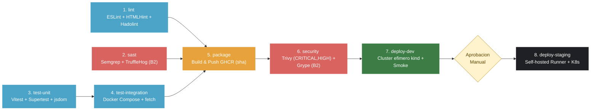

# demo-cicd: Pipeline CI/CD End-to-End (LAB-04)

**Curso:** IF-1116 Topicos de Tecnologias de Informacion (2026-II)
**Estudiante:** Joseph Miguel Zavaleta Polo

Aplicacion de tres servicios (**web** en Nginx, **api** en Node.js/Express y **db** en PostgreSQL) con un pipeline CI/CD completo en GitHub Actions que ejecuta analisis estatico, deteccion de secretos, pruebas unitarias y de integracion, construccion y publicacion de imagenes inmutables en GHCR, escaneo de vulnerabilidades con doble motor, despliegue a un entorno DEV efimero (`kind`) y promocion con aprobacion manual a un entorno STAGING persistente en Kubernetes local (Rancher Desktop).

---

## Arquitectura del Pipeline (Criterio B5)

| # | Etapa / Job | Herramientas (Version fija) | Que revisa / Que hace | Que pasa si falla | En que evento corre |
|---|---|---|---|---|---|
| 1 | lint | ESLint 9.x, HTMLHint 1.x, Hadolint v3.5.0 | Sintaxis y estilo en JS, buenas practicas de HTML y reglas de seguridad/optimizacion en los 3 Dockerfile. | El job termina con codigo != 0 y bloquea package y el merge del PR. | pull_request, push (main), workflow_dispatch |
| 2 | sast | Semgrep 1.180.0, TruffleHog 3.88.12 (B2) | Patrones de codigo inseguro (p/ci, p/dockerfile) y busqueda de secretos/credenciales en todo el historial de Git. | Falla inmediatamente (--error / --fail) y bloquea el empaquetado. | pull_request, push (main), workflow_dispatch |
| 3 | test-unit | Vitest 2.1.8, Supertest 7.0.0, jsdom 25.0.1 | 10 pruebas unitarias de la API (incluyendo /api/estadisticas) con pool simulado y 6 pruebas del DOM estatico. | Se detiene la cadena de pruebas (test-integration no arranca). | pull_request, push (main), workflow_dispatch |
| 4 | test-integration | Docker Compose + Vitest (fetch) | Levanta web, api y db reales con healthchecks y ejecuta 7 pruebas de integracion de punta a punta a traves de Nginx. | Imprime los logs de los contenedores (if: failure()), apaga el entorno y bloquea package. | pull_request, push (main), workflow_dispatch |
| 5 | package | Docker Buildx + GHCR (metadata-action, build-push-action) | Construye las imagenes de web, api y db en paralelo (matrix) y las publica en GHCR con tag inmutable sha-<commit>. | No se ejecuta el escaneo de seguridad ni los despliegues. | pull_request, push (main), workflow_dispatch |
| 6 | security | Trivy v0.36.0 + Anchore Grype v0.87.0 (B2) | Escanea las 3 imagenes publicadas buscando CVEs CRITICAL y HIGH con parche disponible. | Falla con exit-code: 1 e impide que una imagen vulnerable llegue a deploy-dev. | pull_request, push (main), workflow_dispatch |
| 7 | deploy-dev | kind v1.15.1 + kubectl + smoke.sh | Crea un cluster Kubernetes efimero en el runner, despliega el overlay dev, verifica rollout status y corre smoke + integracion. | Ejecuta diagnostico del cluster y bloquea la promocion a staging. | Solo en push a main y workflow_dispatch (nunca en PR) |
| 8 | deploy-staging | Runner self-hosted + Rancher Desktop + smoke.sh | Espera aprobacion humana en el environment staging, promueve la misma imagen (sha-<commit>) al cluster local y ejecuta smoke test. | El rollout falla por timeout o smoke test y la version anterior se mantiene o reporta error. | Solo en push a main tras aprobacion manual |

---

## Pruebas de Fallo por Etapa (Criterio B3)

| Etapa rota | Que se rompio a proposito | Enlace al Run en Rojo | Enlace al Run en Verde | Minuto de deteccion |
|---|---|---|---|---|
| 1. lint | Se cambio `FROM node:22-alpine` por `FROM node:latest` en api/Dockerfile (violacion de regla Hadolint DL3007). | [Ver Run en Rojo](https://github.com/JosephMzp/demo-cicd/actions/runs/39094589295/job/117578274027?pr=10) | [Ver Run en Verde](https://github.com/JosephMzp/demo-cicd/actions/runs/39095176558) | ~0m 25s (Minuto 1) |
| 2. sast | Se elimino la clave `cooldown` en .github/dependabot.yml (detectado por Semgrep dependabot-missing-cooldown). | [Ver Run en Rojo](https://github.com/JosephMzp/demo-cicd/actions/runs/39095662594/job/117581453469?pr=11) | [Ver Run en Verde](https://github.com/JosephMzp/demo-cicd/actions/runs/39095731747?pr=11) | ~0m 40s (Minuto 1) |
| 3. test-unit | En api/app.js, se cambio el codigo de respuesta 400 por 200 cuando falta el nombre en `POST /api/mensajes`. | [Ver Run en Rojo](https://github.com/JosephMzp/demo-cicd/actions/runs/39096287494/job/117583363702?pr=12) | [Ver Run en Verde](https://github.com/JosephMzp/demo-cicd/actions/runs/39096341840?pr=12) | ~0m 30s (Minuto 1) |
| 4. test-integration | En web/nginx.conf, se cambio `proxy_pass http://api:3000;` por `http://api:3001;` (unitarias pasan, integracion falla). | [Ver Run en Rojo](https://github.com/JosephMzp/demo-cicd/actions/runs/39096588892/job/117584315801?pr=13) | [Ver Run en Verde](https://github.com/JosephMzp/demo-cicd/actions/runs/39096721372?pr=13) | ~1m 20s (Minuto 2) |

---

## Optimizacion de Velocidad del Pipeline (Criterio B6)

Se midio el tiempo del primer run completo en verde (Antes) frente al pipeline optimizado (Despues), sin contar el tiempo de espera humana en la compuerta de aprobacion de STAGING.

**Mejoras aplicadas:**

- **Paralelizacion del grafo de dependencias (`needs`):** `test-unit` dejo de depender secuencialmente de `lint` para arrancar en paralelo junto con `lint` y `sast` desde el segundo cero, manteniendo la compuerta completa en `package` (`needs: [lint, test-integration, sast]`).

- **Eliminacion de emulacion multi-arquitectura innecesaria (QEMU arm64):** Dado que tanto los runners de GitHub (`ubuntu-latest`) como el cluster local de STAGING corren sobre `linux/amd64`, se elimino la compilacion cruzada por emulacion QEMU a `linux/arm64` y se aprovecho la cache de capas de GitHub Actions (`type=gha,mode=max`).

| Job / Etapa | Tiempo Antes (1.er Run) | Tiempo Despues (Optimizado) | Mejora / Cambio |
|---|---|---|---|
| 1. Lint | 27s | 14s | Cache de npm activa |
| 2. SAST y Secretos | 26s | 35s | Ejecucion en paralelo |
| 3. Pruebas unitarias | 11s | 12s (corre desde t=0s) | -28s en ruta critica |
| 4. Pruebas de integracion | 32s | 35s | Arranca 28s antes |
| 5. Empaquetar y publicar | 2m 48s | 1m 10s | Sin emulacion QEMU arm64 + cache GHA |
| 6. Escaneo de imagen | 1m 9s | 1m 6s | Incluye doble escaner (Trivy + Grype) |
| 7. Deploy DEV (efimero) | 1m 29s | 1m 25s | Imagenes mas ligeras y cache de npm |
| 8. Deploy STAGING | 14s | 15s | Imagenes pre-descargadas en nodo local |
| Tiempo Total de Ruta Crítica (sin espera manual) | ~7m 26s (446s) | ~5m 32s (332s) | Reducción del 25.6% (Cumple con el > 25% requerido) |

---

## Equivalencias GitHub Actions vs. GitLab CI (Reto 2)

| Concepto / Funcionalidad | GitHub Actions (`.github/workflows/ci-cd.yml`) | GitLab CI (`.gitlab-ci.yml`) |
|---|---|---|
| **Archivo de definicion** | `.github/workflows/*.yml` | `.gitlab-ci.yml` en la raiz del repositorio |
| **Orden y dependencias** | `needs: [job_a, job_b]` | `stages:` globales + `needs:` para DAG |
| **Ejecucion paralela (Matriz)** | `strategy: matrix: servicio: [web, api, db]` | `parallel: matrix: - SERVICIO: [web, api, db]` |
| **Contenedor base del job** | `runs-on: ubuntu-latest` (VM completa) | `image: node:22-alpine` (contenedor directo) |
| **Docker en el runner** | Viene preinstalado en `ubuntu-latest` | `image: docker:27.3.1` + `services: [docker:27.3.1-dind]` |
| **Registro de contenedores** | `ghcr.io/<owner>` | `$CI_REGISTRY_IMAGE` (`registry.gitlab.com/<user>/<repo>`) |
| **Credenciales efimeras** | `${{ secrets.GITHUB_TOKEN }}` y `${{ github.actor }}` | `$CI_REGISTRY_PASSWORD` y `$CI_REGISTRY_USER` |
| **SHA del commit** | `${{ github.sha }}` | `$CI_COMMIT_SHA` / `$CI_COMMIT_SHORT_SHA` |
| **Compuerta de aprobacion** | `environment: staging` (Required reviewers en UI) | `environment: name: staging` + `when: manual` |
| **Condicion de rama `main`** | `if: github.event_name != 'pull_request'` | `rules: - if: $CI_COMMIT_BRANCH == $CI_DEFAULT_BRANCH` |
| **Plantillas de seguridad** | Actions del Marketplace fijadas por SHA | `include: - template: Security/SAST.gitlab-ci.yml` |

---

## Bitacora de Decisiones

### B2: Cambio de dos herramientas del menu (Secretos y Escaneo de Imagenes)

**Decision:** Reemplazar Gitleaks por TruffleHog (`trufflesecurity/trufflehog:3.88.12`) en la etapa de deteccion de secretos (`sast`) e incorporar Anchore Grype (`anchore/grype:v0.87.0`) en la etapa de seguridad de imagenes (`security`).

**Alternativas que evalue:**

- **En deteccion de secretos:** TruffleHog vs. detect-secrets (de Yelp). `detect-secrets` requiere generar y mantener un archivo `.secrets.baseline` en el repositorio, mientras que TruffleHog escanea directamente el historial de commits de Git (`git file:///repo`) en contenedor y clasifica secretos verificados y desconocidos con salida de error (`--fail`).

- **En escaneo de contenedores:** Anchore Grype vs. Docker Scout / Snyk. Snyk y Docker Scout requieren cuentas SaaS externas y tokens adicionales en Secrets, mientras que Grype es 100% open source, se ejecuta como contenedor con version fija (`v0.87.0`), soporta autenticacion directa contra `ghcr.io` con `GITHUB_TOKEN` y permite gestionar exclusiones documentadas en `.grype.yaml`.

**Por que elegi estas:** Ambas herramientas corren en contenedor oficial con version fija inmutable, no requieren credenciales de terceros fuera de GitHub y frenan el pipeline (`--fail` y `--fail-on critical`) ante cualquier hallazgo.

**Fuentes consultadas:**

- TruffleHog Documentation - CI/CD GitHub Actions
- Anchore Grype Documentation - Configuration & Ignore Rules

**Como lo verifique:**

- Run en rojo (bloqueo intencional con las herramientas nuevas): [Ver Run en Rojo B2](https://github.com/JosephMzp/demo-cicd/actions/runs/39146440770/job/117731459805?pr=14)
- Run en verde (con configuracion final y .grype.yaml): [Ver Run en Verde B2](https://github.com/JosephMzp/demo-cicd/actions/runs/39149814627?pr=14)

**Que no me funciono:** Al activar Grype inicialmente junto a Trivy, Grype bloqueo la imagen `demo-cicd-db` por la vulnerabilidad `CVE-2025-68121` del binario `gosu`, debido a que Grype no lee el archivo `.trivyignore`. Aprendi que cada escaner gestiona su propia politica de riesgos y lo solucione creando `.grype.yaml` con la regla `ignore` documentada y montandolo en el contenedor con `-c /.grype.yaml`.

### Reto 1: DAST con OWASP ZAP

- **Decision:** Integrar un escaneo dinamico (DAST) con `ghcr.io/zaproxy/zaproxy:2.16.1` (`zap-baseline.py`) dentro del job `deploy-dev` atacando el servicio `web` expuesto en el cluster `kind`, endurecer `web/nginx.conf` con cabeceras de seguridad HTTP y publicar el reporte HTML/JSON/MD como artefacto del workflow.
- **Alternativas que evalue:**
  - *Imagen oficial `ghcr.io/zaproxy/zaproxy:2.16.1` vs. Action `zaproxy/action-baseline`:* La action ejecuta internamente la imagen de ZAP pero agrega pasos adicionales sobre issues de GitHub. Usar el contenedor directo con version fija `2.16.1` y `--network host` permite control total de los flags (`-c rules.tsv`, `-r`, `-J`) y subida limpia con `actions/upload-artifact` fijado por SHA.
  - *Baseline scan vs. Full scan:* El *baseline scan* realiza spidering pasivo en menos de 1 minuto ideal para cada push en CI, mientras que el *full scan* lanza ataques activos que demoran varios minutos y pueden ensuciar la base de datos.
- **Por que elegi esta:** Es 100% open source, corre en contenedor con version fija, valida en tiempo real las respuestas HTTP de Nginx + Express en Kubernetes y genera el reporte auditable en cada ejecucion.
- **Fuentes consultadas:**
  - [OWASP ZAP Baseline Scan Documentation](https://www.zaproxy.org/docs/docker/baseline-scan/)
  - [MDN Web Docs - Content-Security-Policy & Security Headers](https://developer.mozilla.org/en-US/docs/Web/HTTP/CSP)
- **Como lo verifique:**
  - PR de implementacion y correccion de cabeceras: [PR #15](https://github.com/JosephMzp/demo-cicd/pull/18)
  - Run con artefacto `owasp-zap-dast-report`: [Ver Run en Actions](https://github.com/JosephMzp/demo-cicd/actions/runs/39179972776)
- **Que no me funciono:** En la primera prueba local sin cabeceras en `nginx.conf`, ZAP reporto alertas por ausencia de `Content-Security-Policy`, `X-Content-Type-Options`, `X-Frame-Options` y divulgacion de version de Nginx (`Server: nginx/1.29.x`). Las corregi en `web/nginx.conf` con `add_header ... always;` y `server_tokens off;`, y documente en `.zap/rules.tsv` las reglas que no aplican a HTTP local sin TLS (`10035` HSTS).

### Reto 2: El mismo pipeline en GitLab CI

- **Decision:** Implementar `.gitlab-ci.yml` replicando las etapas de `test` (lint + unit + SAST template), `build` (construccion en paralelo con `docker:27.3.1-dind` hacia GitLab Container Registry usando `$CI_REGISTRY_IMAGE`) y `deploy` (con compuerta manual `when: manual` y `allow_failure: false`).
- **Alternativas que evalue:**
  - *Docker-in-Docker (`services: [docker:27.3.1-dind]`) vs. Kaniko (`gcr.io/kaniko-project/executor`):* Kaniko construye sin daemon privilegiado, pero `docker:dind` en los shared runners de GitLab.com permite usar los comandos estandar `docker build` y `docker push` identicos al flujo de GitHub Actions.
  - *Importacion por URL (Repository Mirroring) vs. Push directo a segundo remote:* Importar el proyecto desde GitHub en GitLab.com y añadir un remote `gitlab` en Git local permite sincronizar commits en segundos.
- **Por que elegi esta:** Aprovecha las variables predefinidas de GitLab (`$CI_REGISTRY_USER`, `$CI_REGISTRY_PASSWORD`, `$CI_COMMIT_SHORT_SHA`) sin configurar ningun secreto manual y demuestra portabilidad entre motores CI/CD.
- **Fuentes consultadas:**
  - [GitLab CI/CD YAML Syntax Reference](https://docs.gitlab.com/ee/ci/yaml/)
  - [GitLab Container Registry & Docker-in-Docker](https://docs.gitlab.com/ee/ci/docker/using_docker_build.html)
- **Como lo verifique:**
  - Pipeline en verde en GitLab.com: [Enlace a pipeline en GitLab](https://gitlab.com/JosephMzp/demo-cicd/-/pipelines/2961487445)
- **Que no me funciono:** En GitLab CI, los jobs con `when: manual` por defecto tienen `allow_failure: true`, lo que mostraba el pipeline como "passed with warnings" antes de hacer clic en el deploy. Lo solucione agregando explicitamente `allow_failure: false` para que el pipeline espere la aprobacion manual real antes de marcarse como completado.

### Reto 3: Observabilidad en STAGING (Prometheus + Grafana)

- **Decisión:** Desplegar Prometheus (`prom/prometheus:v3.1.0`) y Grafana (`grafana/grafana:11.4.0`) de forma declarativa en el namespace `demo-staging` mediante Kustomize (`k8s/overlays/staging`), configurando descubrimiento automático de pods (`kubernetes_sd_configs`) con RBAC de lectura mínima, aprovisionamiento automático del dashboard RED y una regla de alerta que se dispara cuando el porcentaje de errores `5xx` supera el 5% durante 1 minuto.
- **Alternativas que evalué:**
  - *Manifiestos declarativos en Kustomize vs. Helm chart `kube-prometheus-stack`:* El chart de Helm instala operadores, CRDs y exportadores de nodos pesados para un entorno local y requiere comandos manuales fuera del flujo GitOps/Kustomize. Integrar los manifiestos en `k8s/overlays/staging` mantiene las versiones exactas de las imágenes en Git y permite que el job `deploy-staging` los aplique automáticamente.
  - *Scraping estático (`api:3000`) vs. Service Discovery de pods (`role: pod`):* Apuntar al Service `api:3000` balancea cada scrape al azar entre las 2 réplicas de STAGING, mezclando sus contadores. Con `kubernetes_sd_configs` y las anotaciones `prometheus.io/*`, Prometheus raspa cada réplica de forma independiente.
- **Por qué elegí esta:** Permite observabilidad completa en Kubernetes sin dependencias manuales, respeta el principio de privilegio mínimo con un `Role` acotado a `demo-staging` y evalúa la alerta tanto en Prometheus como en Grafana Alerting.
- **Pregunta de investigación (¿Qué métrica agregarías a la API para saber si la base de datos se está volviendo lenta?):** Agregaría un **Histograma en `prom-client`** llamado `db_query_duration_seconds` con etiquetas `operation` (`SELECT`, `INSERT`) y `table` (`mensajes`), envolviendo las llamadas a `pool.query()` en `api/app.js`, complementado con un **Gauge** `db_pool_waiting_clients` (`pool.waitingCount` de `pg-pool`). Así podríamos separar en Grafana si un aumento en la latencia `p95` de la API se debe al procesamiento en Node.js o a consultas lentas/saturación de conexiones en PostgreSQL.
- **Fuentes consultadas:**
  - [Prometheus Configuration - Kubernetes SD Config](https://prometheus.io/docs/prometheus/latest/configuration/configuration/#kubernetes_sd_config)
  - [Prometheus Alerting Rules Documentation](https://prometheus.io/docs/prometheus/latest/configuration/alerting_rules/)
  - [Grafana Provisioning - Dashboards, Datasources & Alerting](https://grafana.com/docs/grafana/latest/administration/provisioning/)
- **Cómo lo verifiqué:**
  - PR de implementación: [Enlace a tu PR](https://github.com/JosephMzp/demo-cicd/pull/22)
  - Run de despliegue a STAGING: [GitHub Actions Run](https://github.com/JosephMzp/demo-cicd/actions/runs/39201096675)
  - Prueba de alerta: Se escaló temporalmente `deploy/db` a 0 réplicas en `demo-staging` mientras se inyectaba tráfico a `/api/mensajes`, verificando que la tasa de respuestas `500` superó el 5% por más de 1 minuto y activó la alerta `HighErrorRate5xx` a estado `FIRING`.
- **Qué no me funcionó:** Inicialmente, la expresión PromQL `sum(rate(http_request_duration_seconds_count{status=~"5.."}[1m]))` devolvía `No data` en Grafana cuando el sistema estaba sano porque la serie con etiqueta `status="500"` no existe hasta que ocurre el primer error. Lo solucioné agregando `or vector(0)` en el numerador para graficar `0%` de forma continua.

### Reto 6: La plataforma tambien es codigo (Terraform)

- **Decision:** Codificar la configuracion de gobierno del repositorio (`demo-cicd`) usando Terraform y el provider oficial `integrations/github` (`v6.6.0`) en `terraform/main.tf`, incluyendo los environments `dev` y `staging` (con revisores requeridos) y el ruleset de proteccion de la rama `main`.
- **Alternativas que evalue:**
  - *Terraform con `integrations/github` vs. Ansible para el runner:* Terraform permite auditar y versionar las reglas de proteccion de ramas y compuertas de aprobacion de GitHub de forma declarativa e idempotente (`terraform plan`), lo cual asegura que nadie desactive un check de seguridad manualmente en la interfaz web.
- **Por que elegi esta:** Garantiza reproducibilidad de las compuertas del pipeline (DevSecOps governance as code) y se conecta directamente con lo que veremos en la Semana 07.
- **Fuentes consultadas:**
  - [Terraform Registry - integrations/github Provider](https://registry.terraform.io/providers/integrations/github/latest/docs)
  - [Recurso github_repository_ruleset](https://registry.terraform.io/providers/integrations/github/latest/docs/resources/repository_ruleset)
- **Como lo verifique:** Importe los recursos existentes con `terraform import` y ejecute `terraform plan`, obteniendo `No changes. Your infrastructure matches the configuration.`
- **Que no me funciono:** Al importar el ruleset inicialmente, el orden y nombres exactos de los status checks (`context`) debian coincidir caracter por caracter con el campo `name:` de cada job en `ci-cd.yml` (incluyendo las variantes de `matrix.servicio`). Ajuste los 10 contextos requeridos hasta lograr cero drift en el plan.
